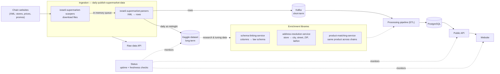

# Open Israeli Supermarkets

Open, reliable access to the prices, promotions and stores that Israeli supermarket chains publish under the
price-transparency law ([שקיפות מחירים](https://www.gov.il/he/departments/legalInfo/cpfta_prices_regulations)).

Every chain publishes its own XML files, on its own site, in its own variant of the schema the law defines. This
organization turns that into one end-to-end pipeline that is **low latency, accurate and monitored**: scrape every
chain, parse the files, publish a daily dataset, and serve cleaned, linked data through an API.

- 📦 **Daily dataset:** [erlichsefi/israeli-supermarkets-2024 on Kaggle](https://www.kaggle.com/datasets/erlichsefi/israeli-supermarkets-2024)
- 🌐 **Website:** [openisraelisupermarkets.co.il](https://www.openisraelisupermarkets.co.il/)
- 🔌 **API (live):** [data.openisraelisupermarkets.co.il](https://data.openisraelisupermarkets.co.il/)
- 🟢 **Status page:** [openisraelisupermarkets.github.io/Status](https://openisraelisupermarkets.github.io/Status/)

---

## Architecture

### How data flows

1. **Scrape.** [`israeli-supermarket-scarpers`](https://github.com/OpenIsraeliSupermarkets/israeli-supermarket-scarpers)
   downloads the store, price and promo files of every chain listed on gov.il. It can write to disk or stream each
   file into an in-memory queue as soon as it is downloaded, so nothing waits on disk I/O.
2. **Parse.** [`israeli-supermarket-parsers`](https://github.com/OpenIsraeliSupermarkets/israeli-supermarket-parsers)
   consumes those files (from a folder or straight from the queue) and turns each chain's XML into flat rows,
   writing them to CSV, Kafka, MongoDB or another queue.
3. **Orchestrate and publish.** [`daily-publish-supermarket-data`](https://github.com/OpenIsraeliSupermarkets/daily-publish-supermarket-data)
   runs scraping and parsing in a loop through the day, pushes rows to short-term storage (Kafka in production),
   publishes a new version of the Kaggle dataset at midnight, and serves a raw-data API. A heartbeat health check
   restarts the service if it stalls.
4. **Link, clean and enrich.** Three libraries make the raw rows comparable across chains:
   - [`schema-linking-service`](https://github.com/OpenIsraeliSupermarkets/schema-linking-service) maps each chain's
     columns to the fields the law defines, fixes or flags every value, and scores data quality per field.
   - [`address-resolution-service`](https://github.com/OpenIsraeliSupermarkets/address-resolution-service) resolves
     store records into a validated city, street, house number, ZIP code and coordinates.
   - [`product-matching-service`](https://github.com/OpenIsraeliSupermarkets/product-matching-service) finds the same
     product across 30+ chains (exact barcode for global items, text similarity for chain-internal items) and keeps a
     unified catalog.
5. **Serve.** A processing pipeline consumes Kafka, loads the data into PostgreSQL and backs the public API, live at
   [data.openisraelisupermarkets.co.il](https://data.openisraelisupermarkets.co.il/), and the website. The live
   deployment (Kafka, PostgreSQL, the data fetcher, the ETL pipeline, the API, the website and the tunnel that exposes
   them) is defined with Docker Compose in [`erlichsefi/supermarket-pipeline`](https://github.com/erlichsefi/supermarket-pipeline)
   (private for now).
6. **Monitor.** [`Status`](https://github.com/OpenIsraeliSupermarkets/Status) checks the website and API every 5
   minutes and the Kaggle dataset's freshness every hour from GitHub Actions, publishes the results as a status page,
   and alerts on Discord when a check fails or recovers. The scrapers and parsers also run their test suites daily
   against the live chain sites, so a chain changing its interface shows up as a red badge.

---

## Repositories

| Repository | Role | Install / run |
|---|---|---|
| [israeli-supermarket-scarpers](https://github.com/OpenIsraeliSupermarkets/israeli-supermarket-scarpers) | Downloads every chain's published files | `pip install il-supermarket-scraper` · Docker `erlichsefi/israeli-supermarket-scarpers` |
| [israeli-supermarket-parsers](https://github.com/OpenIsraeliSupermarkets/israeli-supermarket-parsers) | Parses the XML into rows (CSV, Kafka, MongoDB, queue) | `pip install il-supermarket-parser` · Docker `erlichsefi/israeli-supermarket-parsers` |
| [daily-publish-supermarket-data](https://github.com/OpenIsraeliSupermarkets/daily-publish-supermarket-data) | Runs scrape → parse continuously, publishes to Kaggle daily, serves the raw-data API | Docker `erlichsefi/data-fetcher` |
| [schema-linking-service](https://github.com/OpenIsraeliSupermarkets/schema-linking-service) | Links chain columns to the law's schema, normalizes values, scores data quality | Python library |
| [address-resolution-service](https://github.com/OpenIsraeliSupermarkets/address-resolution-service) | Resolves store addresses to city, street, ZIP and lat/lon | Python library |
| [product-matching-service](https://github.com/OpenIsraeliSupermarkets/product-matching-service) | Matches products across chains and maintains a unified catalog | Python library + batch scripts |
| [Status](https://github.com/OpenIsraeliSupermarkets/Status) | Public status page and alerting | GitHub Actions + GitHub Pages |
| [erlichsefi/supermarket-pipeline](https://github.com/erlichsefi/supermarket-pipeline) (private) | Defines and deploys the live stack behind data.openisraelisupermarkets.co.il | Docker Compose |

The two packages keep their chain lists in sync: every parser name in `ParserFactory` must match a scraper in
`ScraperFactory`, which the parsers' tests enforce.

### Accuracy loop

The enrichment libraries share one way of improving accuracy: a labeled dataset drawn from the Kaggle data, a
supervised evaluation against it, and an "autoresearch" tuning loop (agents and skills under each repo's
`.claude/`) that fixes one error cluster at a time and keeps a change only if the evaluation improves. Expensive
lookups (geocoding, Israel Post ZIPs, LLM research) are cached in Kaggle datasets so every run reuses them.

---

## Roadmap

### Next goal: public supermarket data website

- **Goal:** a GA application to access supermarket data, for anyone who reads the chains' sites directly today.
- **How:** stable remote infrastructure; an API that supports a few dozen customers; reliable data processing; data
  served in each chain's schema; only daily data in the API; understanding minimal hosting requirements.
- **Additional goals:** host a hackathon on data-science challenges built from the Kaggle dataset; create a landing
  page.

### V1: Reducing latency

- **Scrapers:** write XML to a stream instead of disk; one queue per chain; write execution status to a database
  instead of JSON files.
- **Parsers:** pull from the queue instead of disk; write parsed results per file type and chain, keeping all
  versions; investigate further latency reductions.
- **Stability:** scraper stress tests (impact of CPU allocation on timeouts); error analysis so Kaggle gets correct
  data.
- **Kaggle dump:** turn the short-term store into a Kaggle dataset version and publish it.

### V2: One schema across all chains, and search

- **Customers:** GenAI applications.
- **Schema linking:** link schemas between chains and compute product prices across chains.
- **Promotions:** apply promotions to product prices.
- **Schema transformation:** run schema transformations on a CSV and evaluate them on random Kaggle versions.
- **Search:** text search across any textual column, with merging and pre-filtering of results; support search
  from natural-language queries.

### V3: Product comparison

- **Customers:** comparison applications and price-comparison platforms.
- **How:** minimal retention for in-day changes; an **Alternatives API** that finds equivalent products across
  chains.

### V4: Time-series analysis

- **Customers:** price prediction and trend detection.
- **How:** load the historical Kaggle data into the database.

### V5: Monitoring and user access

- **Customers:** internal stakeholders and users.
- **How:** a monitoring page for pipeline status and a page publishing data-quality metrics.

---

## Contributing

Issues and pull requests are welcome in any repository. If you are not sure where something belongs, the diagram
above is the map: problems downloading a chain go to the scrapers, malformed rows to the parsers, wrong
field values to schema linking, wrong store locations to address resolution, and wrong product matches to product
matching. Questions: erlichsefi@gmail.com.
